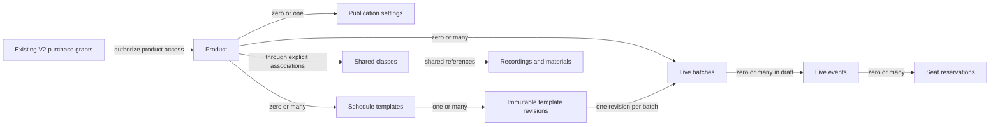

# V2 Phase 2 data relationships and Admin form plan

Status: Draft — wider publishing design; template, batch and private meeting drafts implemented locally
Owner: Engineering and product owner
Last updated: 19 October 2026

Part 2 defines a proposed contract for product-specific publishing, independent
live schedules and the Admin form. The design proposes keeping the routes and
records serving existing students intact. It builds on the [Task 1 source mapping](preparation-checklist.md#product-mapping)
at `3207cba41b0561ef78c0adf5a44302d753d48bdb` on `intern/v2-onboarding`.

Local implementation proceeds under a limited sequencing exception. The
[implementation checkpoint](README.md) records the limited sequencing exception,
template/batch draft code and local test evidence. Local commits track the work;
push, external publication, shared database operations and deployment still
require explicit permission.
Phase 1 acceptance and the wider product decisions remain pending.

The [private meeting draft implementation](meeting-drafts.md) adds Admin-only
link storage and editing. It does not implement the proposed reservation or
student retrieval contracts. Publishing remains blocked pending D5, and D3 batch
selection is still undecided as recorded in the preparation checklist.

## Design basis and limits

The [Phase 2 roadmap][roadmap] requires Full Batch and Crash Course publishing,
independent schedules, configurable durations, recording-only Crash Courses and
schedule updates visible to entitled students. [LIVE-01 through LIVE-05][live-criteria]
separate live participation from purchased website access. [SEC-01 through SEC-04][security-criteria]
require protected resources, isolation, environment safety and evidence.

The remaining sections are engineering proposals. Product decisions in
[D1–D7](preparation-checklist.md#decisions-and-inputs-register) remain open where
not explicitly settled by those requirements. Table names, route names and exact
database representation are not an approved migration specification.

| Source fact | Design implication |
|---|---|
| [The current template reader][legacy-template-reader] loads all `course_templates`; [the schema][legacy-template-keys] restricts keys to the older four templates | New V2 templates should use separate records and an explicit reader, rather than appearing in the current editor automatically |
| [Batch creation][legacy-batch-create] writes legacy courses, sessions and inherited materials | Reuse the scheduling concepts and reviewed interaction patterns, not the existing mutation RPC as a shortcut |
| [The legacy timeline][legacy-timeline] selects a course enrollment and preserves access to inactive enrolled batches | Product publication and live availability must not alter legacy enrollment or course activation |
| [Phase 1 products][product-schema] have explicit section scopes; [the access guard][product-guard] verifies the caller's current product access | Use product codes for authorization; titles, template names and shared class IDs never grant access |
| [The proposal builder][schedule-builder] pins a revision and uses `Asia/Kolkata` | Retain revision checks and deterministic time conversion in the V2 design; validate any reused helper against V2 cases |

Separate records reduce coupling; they do not establish compatibility by
themselves. Shared layouts, authentication, database dependencies and deployment
configuration still require the regression checks below. Production state has
not been inspected during this planning task.

## Proposed relationships

A **product** defines purchased access. A **class** is reusable learning content.
A **template** describes a reusable schedule. A **batch** is one actual live run
of that product. A **reservation** gives an eligible student a seat in one live
event. None of these objects substitutes for a purchase grant.

| Record | Proposed relationship and fields | Required invariant |
|---|---|---|
| Product | Existing `v2_products`: product code, kind and fixed purchased sections | Reuse the four Phase 1 identities; no new price or purchase logic in Phase 2 |
| Publication settings | At most one V2 record per product: display title, summary, listing state and version | No live dates required. Publishing metadata does not grant access; hiding a listing does not modify purchase grants |
| Template | One product per template; a product may have several templates; template ID, name and current revision | A template cannot be rebound to a different product after use |
| Template revision | One template; immutable revision ID, approved class references, relative schedule offsets, duration defaults and versioned parameters | Existing batches retain their selected revision; no automatic synchronization to the newest template |
| Live batch | Exactly one product and one revision from a template for that same product; batch ID, title, start date, time zone, state and version | No cross-product revision binding; a recording-only product needs zero live batches |
| Live event | Exactly one batch; stable event ID, title, section, optional class reference, start/end timestamps, instructor, state and capacity | Class section must belong to the batch product. Shared classes do not share mutable dates, capacity or reservations |
| Private join details | Zero or one protected record per event; Google Meet reference and version | Stored/read separately from generally readable schedule fields; never embedded in titles, summaries or public payloads |
| Reservation | One student and one event; stable ID, reservation state and timestamps | At most one active seat per student/event; no purchase creation, expiry reset or ownership chosen by the browser |
| Shared class | Stable class reference with canonical section and content identity; reusable across appropriate products | Physical mapping to existing master content or new V2 content records depends on D1/D7; no automatic conversion of legacy IDs |
| Product class association | One product and one shared class, with order and section metadata | Explicit many-to-many reuse; including a class in two products grants access only through an actual product grant |
| Recording/material association | Shared resource references attached to classes or the product's included material set | References are independent of live attendance, live batch dates and individual students; playback/authoring remain later-phase work |

New persisted publishing records are proposed for a dedicated `v2_*` namespace.
The exact table split, normalized revision representation, indexes and foreign keys
belong in the migration design after this contract is reviewed. A diagram arrow
is a proposed design rather than a shared-migration approval. The later local
draft-authoring implementation is recorded separately in the checkpoint and the
[batch draft record](batch-drafts.md). That implementation currently stores events
inside immutable batch revision documents, scoped by batch and event key; the
separate event/reservation records proposed here are not yet implemented.

### Relationship rules

1. Product scope is server-derived: Full Batch includes `quant`, `verbal` and `di`;
   each Crash includes only its purchased section. [Phase 1 schema][product-schema]
2. A batch belongs to one product. Full Batch and Crash schedules remain independent
   even when they use the same underlying class recordings.
3. A template revision is a starting snapshot. Later batch edits affect only that
   batch and do not mutate the source template or another batch.
4. Recording-only delivery consists of published product details plus reviewed
   content associations and no live batch. It does not need a fake date, event,
   reservation, enrollment or Meet link.
5. Delivery availability is derived from eligible published live batches. Historical
   or cancelled batches do not by themselves make live delivery currently available.
   Admin mode selection guides the form; a second stored flag must not contradict
   the actual live-batch state.
6. Product entitlement remains the Phase 1 access boundary. A reservation is not an
   entitlement, and a batch is not a purchase. Authorization is rechecked at use
   time, including after a student has already reserved a seat.
7. A product may have multiple live batches. Which ones a particular purchaser can
   join is unresolved under D3; storing multiple batches does not choose that policy.
8. Existing course, session, enrollment, payment, material and tracker IDs remain
   unchanged. Legacy `qa`, `va`, `cr` and `rc` codes are not silently renamed.

## Proposed Admin journey

The candidate entry point is a separate V2 publishing area, for example
`/admin/v2/batches`. It does not replace the existing Batches or Templates screen.
Existing navigation remains intact. V2 activation starts in an approved Preview
and staging environment; live exposure requires verified compatibility and a
separate release decision. Existing shared design components may be reused.

| Step | Admin action | Validation and result |
|---|---|---|
| 1. Select product | Choose Full Batch, Quant Crash, Verbal Crash or DI Crash | Included sections are displayed read-only from product configuration |
| 2. Set delivery | Choose recordings/materials only, or add a live batch alongside recordings | Recording-only skips dates, live capacity and Meet fields. Choosing it while live batches exist requires an explicit reviewed unpublish action |
| 3. Associate learning content | Choose reviewed class, recording and material references | Wrong-section, missing and unsupported references are rejected; this is not a new recording upload or Notion editor |
| 4. Configure live schedule | Select a product-specific template, start date and event details | Live path only; preview the generated schedule and its section/instructor/time details |
| 5. Review | Inspect publication state, changed dates, protected link handling and affected reservations | Review performs no mutation. Missing publication requirements are listed next to the affected fields |
| 6. Save or publish | Save an initial draft, publish, update published details, unpublish or republish | Each confirmed operation checks role, current revision and all relevant invariants in one transaction |

For an already published item, editing the form does not change student-visible
data. The proposal uses an explicit **Review changes → Publish changes** action;
successful publication replaces the affected published values atomically. A failed
save keeps the previous version visible and preserves the form for retry. Separate
persisted working drafts for edits to published items are not included in this
initial design; closing an unsaved edit requires an unsaved-changes notice.

### Proposed fields

| Field | Recording-only path | Live path | Validation and source |
|---|---|---|---|
| Product | Required | Required | One catalogue product code; fixed after the record is created |
| Included sections | Read-only | Read-only | Full Batch always all three; Crash exactly one |
| Display title and summary | Title required; summary optional | Title required; summary optional | Trimmed plain text with bounded lengths; protected links cannot be placed here |
| Class/content references | Required before publication, subject to D1/D5 coverage decision | Required before publication, subject to D1/D5 | Existing reviewed content identities; no private raw URLs or real student data in synthetic fixtures |
| Recordings/materials | Explicit association summary | Explicit association summary | Recordings are required by product rules; exact completeness threshold needs D5. A placeholder does not prove playable content |
| Template and revision | Not required | Required | Template belongs to selected product; reviewed revision still current at initial confirmation |
| Batch title | Not applicable | Required | Separate from product identity; changing a title does not change access |
| Start date and time zone | Not applicable | Required | Proposed default `Asia/Kolkata`, matching existing scheduling code; D2 confirms the convention |
| Event class, section and order | Not applicable | Required for teaching events | Stable event identity and explicit product-section association; support/orientation event rules require the supplied schedule |
| Start time and duration | Not applicable | Required per live event | Valid date/time; positive bounded duration; end after start; dates stored as instants and displayed in the chosen zone |
| Instructor | Not applicable | Required before live publication | Display label or approved staff reference; account/provisioning changes excluded |
| Google Meet details | Not applicable | Required before live publication under the proposed default | Private dedicated field with approved HTTPS host validation; missing-link publication exception needs D5 |
| Live capacity | Not applicable | Defaults to eight per live session | Positive integer; not a course-enrollment or purchase limit. Behavior below existing reservations depends on D4 |
| Publication state | Draft, published or unpublished product details | Separate draft, published or unpublished live batch | Does not edit `courses.is_active`, `available_for_purchase`, purchase grants or payment state |
| Expected version and request token | System-managed | System-managed | Used for stale-edit detection and safe retries; not a substitute for authorization |

The approximately eight-week and one-week schedules are defaults, not hard-coded
class dates or a ban on other approved durations. Real class order, schedules and
instructors must come from D1/D2. Technical input limits should be documented when
the form and schema are implemented, without changing the approved product model.

### Publication transitions

| Operation | Proposed behavior | Access and failure boundary |
|---|---|---|
| Create draft | Persist incomplete but structurally valid V2 details for Admin review | No student listing or protected-link disclosure |
| Publish | Validate required content/schedule fields and atomically publish the reviewed version | Missing prerequisites or stale revision leave the draft unchanged |
| Update published | Atomically apply explicitly reviewed changes to one product listing or batch | Old published version remains on failure; purchases and other batches remain unchanged |
| Unpublish live batch | Hide live availability and prevent join-link retrieval/new bookings for that batch | Retain event/reservation history; purchased online access survives. Existing reservations follow the reviewed D4 policy |
| Unpublish product details | Hide the listing; reject ambiguous removal while live batches still depend on it | Proposal: require explicit handling of those batches, with an atomic operation if included. No silent cascade or purchase revocation; D5 approval pending |
| Republish | Revalidate required fields, current versions and resource references | No automatic seat creation, expiry extension or stale link disclosure |
| Cancel live event | Retain the stable event and its history with an explicit cancelled state | Deny new reservations and join-link retrieval; rebooking/refund behavior is not invented by this operation |

For initial publication of both product details and a live batch, the dependent
records must commit together or remain unpublished. An Admin must not publish a
half-configured batch through a lower-level API call. Hard deletion of published
batches or reservations is outside this plan.

Initial live publication requires at least one valid, non-cancelled live event.
Empty event lists are valid for a saved draft, or for recording-only product
publication without a live batch. Completed batches retain their history; their
dates do not make them upcoming batches.

## Mutation and read contracts

Each Admin mutation authenticates an active Admin on the server and at the
database boundary. Student reservation operations authenticate the Student and
derive ownership from that session. The existing [portal role guard][portal-guard]
is a reusable pattern; it does not remove the need for database permissions on
new records.

| Operation | Required input | Required server/database behavior |
|---|---|---|
| Preview schedule | Product, template revision, proposed dates/events | Validate and return a safe preview without writes; no private join details in a public or general student projection |
| Save draft | Product, validated draft fields, expected version and request token | Admin-only; all associations belong to the selected product; no legacy writes |
| Publish/update/unpublish | Target ID, expected version, reviewed changes and request token | Revalidate dependencies, compare current version, apply atomically and increment the version; preserve previous values on failure |
| Read schedules | Caller session and requested product/batch | Derive identity from the session, check current entitlement and the agreed D3 batch policy, return only published allowed metadata |
| Reserve a live seat | Event ID and request token; no caller-selected student identity | Recheck product/batch eligibility, event state and capacity under a database lock/transaction; enforce one active seat per student/event |
| Retrieve Meet details | Event ID and caller session | Active Admin, or active entitled Student with a valid reservation and eligible published event; return only that event's details |

Reservation delivery is still assigned through D4. Phase 2 may not expose Meet
links using only product entitlement while representing that as reservation
enforcement. If reservation delivery is postponed, the dependent live-join path
must remain unavailable until its protection is implemented and tested.

Request tokens are scoped to actor and operation. Identical retries return the
original operation result without duplicate events or seats. Reuse with different
normalized inputs is rejected. A retry must not replay old fields over a newer
published version. Stale revision conflicts require a fresh review rather than
an automatic overwrite. Responses and diagnostics exclude credentials and
private join details unless the specific authorized read requires them.

Publication records retain the server-derived actor ID, action time and resulting
version for review. Client input cannot choose the actor. Operational logs record
safe identifiers and error categories rather than credentials, Meet details or
full request payloads.

### Proposed read permissions

| Caller | Product/schedule information | Meet details | Writes |
|---|---|---|---|
| Active Admin | Draft and published V2 data needed for management | Through the private Admin path | Reviewed publishing operations |
| Active Student with exact product access | Published eligible schedules; D3 determines batch selection | Only with an eligible active live reservation | Own reservation actions once implemented |
| Student with a different product | No protected schedule/resource data for the requested product | Denied | Denied |
| Expired, revoked or inactive Student | No protected data | Denied, including after earlier reservation | Denied |
| Signed-out caller | No new Phase 2 protected read path | Denied | Denied |

Phase 3 may add a separate allowlist of public sales metadata. Public dates or
titles must not carry protected material URLs, Meet details, reservation identities
or purchase history. Client-side filtering is insufficient: readable database
records must not expose private columns through direct queries.

The proposed student schedule view is separate from the legacy timeline and
requires current product authorization on every protected read. A stale client
summary, shared cache entry or earlier successful login never grants continued
access. Missing V2 schema/configuration produces a contained unavailable state;
it does not fall back to legacy enrollment as V2 authorization.

Protecting retrieval cannot invalidate a Meet link already copied outside the
application. Meeting admission controls and any link-rotation process remain an
operational decision; this design makes no guarantee about the external service.

## Existing student compatibility and rollout plan

These are acceptance obligations for later implementation, not checks already run.

- [ ] New V2 tables/functions/routes are additive. Existing template keys, readers, course activation, enrollments, payment handlers, storage policies and tracker ownership remain unchanged.
- [ ] Legacy sign-in, dashboard, schedule, released materials and tracker saves pass with synthetic existing-student fixtures before and after the candidate migration.
- [ ] The same flows pass with V2 disabled and its migration absent. Shared layouts and imports do not execute V2 queries during ordinary legacy requests.
- [ ] New V2 writes cannot update legacy rows through triggers, cascading foreign keys, reused mutation RPCs or automatic template synchronization.
- [ ] Cross-product reads, direct database access, expired access, partial publication failures, stale edits and reservation races have executed tests rather than SQL-text checks alone.
- [ ] The migration is reviewed against the actual staging ledger, including its Phase 1 dependency, with lock/timeout and compatibility impact assessed before application.
- [ ] Feature activation is controlled on the server, defaults off and cannot be enabled by a browser query parameter. Admin authoring and Student exposure can be controlled separately.
- [ ] Staging uses an exact application commit, approved migrations, designated identities and synthetic fixtures; the existing-student and new-product journeys both pass.
- [ ] Snapshot comparisons cover legacy schema, policies and fixture data. Unexpected changes stop the rollout; fixtures are not copied from live students.
- [ ] A reviewed rollout names migrations, code, activation settings, checks, responsible roles and the application rollback artifact. A successful Preview build alone is insufficient.
- [ ] Explicit publication permission is obtained before any push. Local implementation is authorized; shared migrations, merge and deployment require separate approval.

Before any V2 student adoption, disabling the new feature should leave all legacy
journeys intact. Once students depend on V2, disabling their reader is not a safe
rollback: pause new authoring, retain a compatible accepted V2 reader and preserve
all purchase/reservation data. Application rollback must tolerate the additive
schema; dropping new tables or restoring an old database snapshot is not the
routine rollback procedure. The exact post-adoption recovery path requires its
own rehearsal before release.

## Open decisions and planning completion

The [D1–D7 register](preparation-checklist.md#decisions-and-inputs-register) remains
the decision list. Part 2 proposes a separate V2 publishing model, product-level
recording-only publication, immutable template revisions and explicit publish
operations. It does not settle curriculum membership, real schedule dates,
multi-batch eligibility, reservation changes, communication delivery or the actual
deployed schema.

- [x] Product, template, batch, class, grant and reservation relationships are drafted.
- [x] Recording-only delivery and independent live schedules have a proposed representation.
- [x] Admin journey, field requirements and publication transitions are drafted.
- [x] Mutation, read, private-link and failure contracts are drafted.
- [x] Legacy compatibility, staged activation and rollback obligations are recorded.
- [x] Decisions requiring product or schema evidence remain explicitly pending.
- [ ] Product-dependent details are resolved and the design is reviewed.
- [ ] Physical schema and implementation brief are approved against the accepted baseline.
- [ ] Implementation, staging verification and phase acceptance are completed.

Before implementing publication and student delivery, walk through synthetic
Admin and Student examples against this contract: recording-only access, a
published schedule edit, a full live session and an unchanged existing student.
The first three local draft-authoring parts are implemented and tested as recorded
in the [checkpoint](README.md). The broader publishing design remains subject
to review. Phase 2 is tracked locally on `intern/v2-phase-2-drafts`; no branch
publication, shared environment change or deployment has occurred.

## Source references

Line references are pinned conceptually to the inspected application commit above.

[roadmap]: ../review/product-roadmap.md#phase-2--full-batch-and-crash-course-publishing
[live-criteria]: ../review/acceptance-criteria.md#3-live-delivery
[security-criteria]: ../review/acceptance-criteria.md#6-security-and-quality
[legacy-template-reader]: ../../../src/lib/server/courseTemplates.ts#L56
[legacy-template-keys]: ../../../supabase/migrations/20260817090845_add_versioned_course_templates.sql#L11
[legacy-batch-create]: ../../../supabase/migrations/20260817143000_add_batch_schedule_builder.sql#L127
[legacy-timeline]: ../../../supabase/migrations/20260820114212_restore_enrolled_student_inactive_batch_access.sql#L3
[product-schema]: ../../../supabase/migrations/20261018090000_add_v2_product_entitlements.sql#L5
[product-guard]: ../../../src/lib/server/v2Products.ts#L33
[schedule-builder]: ../../../src/lib/batchSchedule.ts#L86
[portal-guard]: ../../../src/lib/server/portalAuthorization.ts#L13
