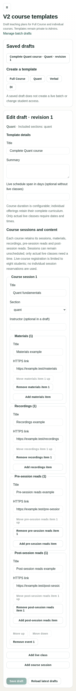

# Complete course model correction — 25 October 2026

PR #24 remains Draft; review is paused until the corrected candidate has a verified
Preview. No shared migration or PR merge is part of this work.

## Decision reconciliation

The latest correction confirms A1, B1 and D1 from the preserved 20 October
approval record. The active business decisions, roadmap and acceptance criteria
now describe complete Quant, Verbal and DI offerings, plus Full Course containing
all three. Individual courses have no assumed one-week curriculum. Older
per-session reservation and WhatsApp requirements are also reconciled to the
later approval record; historical evidence remains dated evidence.

## Implementation

- Canonical Phase 2 codes: `quant`, `verbal`, `di`, `full_course`.
- Proposed schema: `v2_course_offerings`, `v2_course_batches`, and
  `v2_course_batch_revisions`. A private compatibility mapping retains the already
  applied Phase 1 product identifiers and existing purchase/grant behavior.
- Complete session content collections: materials, recordings, pre-session reads,
  post-session reads. Admins can add, edit, remove and reorder references in
  private template drafts. Notion can remain the linked authoring source.
- Template-to-batch snapshots and subsequent rescheduling retain all collections.
  A template edit does not silently change an existing batch's pinned content.
- Unscheduled course content requires no start date or duration. Actual live
  classes still require valid scheduling details.
- Public schedule projections omit private content URLs. Enrolled-batch-only
  Student visibility and the prior local recovery work remain intact.

The applied Phase 1 migration is unchanged: SHA-256
`ff5c9f0f2ae055c6c3b3e2d67fd64390a9ba4b19deaf14a103ddda71e50047b7`.
Proposed Phase 2 migration files were corrected before shared application; these
are not upgrade scripts for databases that independently applied an older draft.

## Local verification

- Phase 1: 128 tests across 14 files passed.
- Phase 2: 182 tests across 15 files passed (181 in the full run, followed by the
  final 18-test template suite including the added incomplete-content regression).
- Browser: 33 scenarios passed, zero failures; actual React components with
  synthetic local adapters, Chromium 155. No external requests were permitted.
- Lint, TypeScript and the webpack production build passed. The build used
  synthetic local configuration with V2 feature flags disabled.

New database checks cover canonical offering scope, unchanged purchase/access
fixtures, private compatibility helpers, content retained through batch creation
and schedule preview, invalid links rejected, and private content excluded from
published schedules. Browser coverage includes all four offering forms and
saving/reopening a complete unscheduled Quant course on mobile.

## Integration with the existing review branch

The corrected local candidate is reconciled with PR #24 head `c67cfe7`, based on
`codex/v2-integration` at `6447f5b`. Two conflicts were resolved: the Phase 2 README
and Phase 1 suite runner. The new correction notes and all 14 Phase 1 suites were
retained; the accepted CI trigger cleanup was preserved. There were no application
code conflicts. This local branch integration does not merge PR #24.

This candidate also brings the previously local Admin recovery, enrolled-batch
schedule reader/roster, browser harness, and offline content-preservation/mapping
tools into the review history. It includes a sixth proposed Phase 2 migration for
enrolled schedules. None of the six proposed Phase 2 migrations has been applied
to a shared environment by this work.

## Remaining acceptance

Complete current course records still need a separately authorized, read-only
inventory and reviewed mappings before any import. The earlier short-format seed
proposal is superseded. No existing content was copied, shortened or deleted.
Protected Student content delivery and independent/universal content publication
are not established by this private authoring correction. Hosted authenticated
acceptance and Phase 2 migration approval remain outstanding.

The earlier green Preview at `c67cfe7` does not validate this correction. The final
handoff must identify the corrected commit and report its own CI/Preview status.
No Production, Flexible Mocks or existing Student/course data was changed.

## Publication status

The fast-forward push to the existing PR branch failed because the local Git
client could not obtain an HTTPS username with terminal prompts disabled. No
remote ref was updated. A new Preview and exact-head hosted CI remain pending.
The final reconciled application, scripts, manifests and migrations are byte-for-
byte identical to tested correction commit `5463f6f`; integration changed only CI
trigger metadata and documentation.
