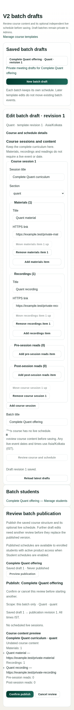

# Phase 2 alignment with the supplemental owner checklist

Date: 25 October 2026. PR #24 remains Draft. Review is paused pending publication
and verification of the corrected Preview. This record follows the screenshots
supplied with the course-model correction; it does not authorize a shared migration.

Phase 2 is **Full Course and Individual Offering publishing**. Quant, Verbal and
DI are complete individual offerings; Full Course contains all three. The active
roadmap and acceptance criteria now use that name and the scoped Admin checklist.

## Corrections beyond the preceding local candidate

The earlier correction preserved content on outline/event records. That did not
make the independent course structure explicit enough. New templates now store
ordered `sessions` independently of `events`. Sessions have a title, section and
four content collections, with no dates, duration, capacity or live-event requirement.
New-template events represent actual live classes. Older prototype outline records
remain readable for compatibility; they are not the shape of newly created courses.

Batch drafts copy and retain the full course sessions separately from their live
schedule. Admins can edit batch content without changing the source template or
another batch. Confirmation records an immutable revision. Publication pins that
complete revision; later draft edits require another preview and confirmation.
Student schedule projections include session headings only, never protected links.

## Checklist and evidence

| Requested Admin behavior | Local evidence |
| --- | --- |
| Create Full Course, Quant, Verbal or DI | Four-form browser test; exact offering/section validation |
| Add sessions and materials | Independent session editor, template and batch save tests |
| Add recordings, pre-reads and post-reads | Four editable content collections; save/reload browser test |
| Add optional live classes with exact dates | Separate live-event editor and existing scheduling validation tests |
| Keep non-live content undated | New sessions reject scheduling fields; entire course can save with no live events/start date/duration |
| Preview before publishing | Admin batch and publication previews show course headings, content titles and exact references before confirmation |
| Edit/unpublish/republish safely | Complete-course database and browser lifecycle tests; immutable revisions and unchanged published content until confirmation |
| Independent schedules/content | Editing one batch leaves its template and another batch intact |
| Keep Meet details Admin-only | Existing private-meeting authorization suites remain passing; no meeting data enters the course or schedule publication projection |

The complete-course database test also rejects wrong-section content, duplicate
session IDs, injected dates and missing content; checks private helper permissions;
and verifies Student output remains sanitized even if private extra fields are
injected into a publication fixture by the test owner.

## Verification

- 128 Phase 1 tests across 14 files passed.
- 185 Phase 2 tests across 15 files passed.
- 34 synthetic browser scenarios passed. Final targeted checks repeat the four
  offering forms and the complete-course content publication flow.
- Lint, TypeScript and the webpack production build passed with local synthetic
  configuration. Browser adapters exercise the actual UI but do not establish
  hosted authentication or database acceptance.

## Boundaries

The canonical Phase 2 product concept contains no compressed-course offerings.
Already-applied Phase 1 commercial identifiers remain only behind the compatibility
mapping. Its migration checksum is still
`ff5c9f0f2ae055c6c3b3e2d67fd64390a9ba4b19deaf14a103ddda71e50047b7`.
No shared Phase 2 migration, existing Student/course-data change, Production change,
Flexible Mocks change or PR merge was performed.

This meets the scoped Admin workflow in local fixtures. It does not establish
real-content migration, protected Student content delivery, independently scoped
item/universal publication, or a fully rendered Student preview of remote content.
The corrected hosted Preview and authenticated acceptance are still outstanding.
